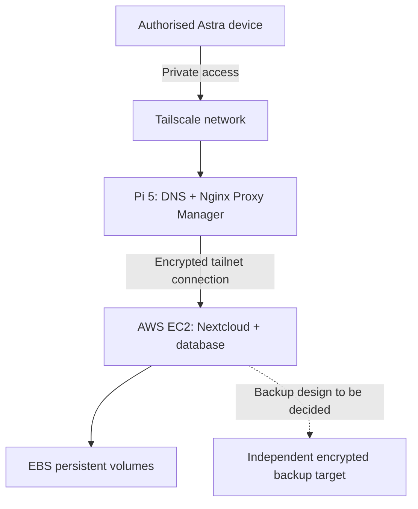

# ADR-003 — Evaluate AWS EC2 for a private Nextcloud deployment

- **Date:** 2026-11-05
- **Status:** Proposed
- **Tags:** aws, linux, containers, networking, dns, security, storage, backup, cost
- **Scope:** Design/feasibility only; no AWS deployment or validation is claimed.

## Context

Astra uses a Raspberry Pi 5 for self-hosted services, private DNS, Nginx Proxy Manager, monitoring, internal PKI and Tailscale access. A Mac mini is under consideration as the primary Nextcloud file-storage host. AWS EC2 is an alternative or complementary learning environment, potentially allowing the application to run away from home while retaining Astra's private naming and access patterns.

## Proposed architecture

- **Proposed private service name:** a hostname in Astra's internal DNS namespace, represented in this public repository as `cloud.astra.example.test` (illustrative only).
- **DNS:** private split DNS should resolve the service name to the existing NPM entry point, not the EC2 public IP.
- **Reverse proxy:** existing NPM would terminate client-side HTTPS and forward through Tailscale to a service bound to a private interface on EC2.
- **EC2:** Linux, containerised Nextcloud and its database with persistent EBS storage; exact instance, region, AMI and volume size remain undecided.
- **Access:** Tailscale policies, host firewall and AWS security groups should prevent unauthorised access; do not expose Nextcloud's HTTP application port or SSH to the public internet.
- **Application:** configure Nextcloud trusted domains, trusted proxies and proxy HTTPS settings before testing external clients.
- **TLS:** validate internal CA trust for clients; encrypt the reverse-proxy-to-EC2 leg using Tailscale and consider HTTPS to the backend as a separate defence-in-depth measure.

## Options to assess

1. **Mac mini primary:** locally controlled storage and lower recurring cloud charges; dependent on home power, broadband and hardware.
2. **EC2 primary:** independent cloud compute and easier cloud-scale experimentation; recurring compute, EBS, IPv4, backup and transfer costs.
3. **Hybrid proof of concept (preferred for evaluation):** retain existing local storage plans while testing a small isolated AWS instance, without automatically synchronising two independent Nextcloud applications.

No production migration or final hosting decision has been made.

## Security and operational concerns

- Establish AWS account Free Tier eligibility and credits **before** launch. Neither an EC2 instance nor its persistent EBS volume is assumed to be free indefinitely.
- Create a budget and billing alerts and verify resource costs, including snapshots, public IPv4, traffic and the cost of keeping an instance running.
- Keep secrets, credentials, key material, live IP addresses and actual private DNS names out of this public repository.
- Do not assume the AWS server is reachable through the home reverse proxy during home power, Pi, ISP or split-DNS outages. Assess an alternative private access route if this failure mode is unacceptable.
- Design database-aware, encrypted, independently retained backups. EBS snapshots alone are not proof of successful application recovery.
- Define a teardown procedure to remove the instance, unused EBS volumes, snapshots and chargeable addresses when the experiment ends.

## Proposed acceptance tests (not yet performed)

- [ ] Verify AWS eligibility, baseline monthly estimate and cost controls.
- [ ] Provision an isolated EC2 Linux instance without unrestricted public inbound application access.
- [ ] Join EC2 to Tailscale and validate authorised private connectivity from Pi.
- [ ] Install Nextcloud and database with persistent storage.
- [ ] Resolve a private name through Astra DNS and proxy HTTPS through NPM.
- [ ] Verify TLS trust, redirects, login and uploads from at least one authorised off-site device.
- [ ] Verify unauthorised access is denied and document security group and Tailscale ACL tests.
- [ ] Simulate loss of the home NPM path and record impact/recovery.
- [ ] Restore application data and database from a backup into a disposable target.
- [ ] Measure cost, resource use and service responsiveness; document rollback/teardown.

## Next decision

After feasibility and cost evaluation, choose whether AWS is retained as a learning-only environment, a private secondary service, or a candidate for primary Nextcloud hosting. Record actual implementation and validated evidence separately.
