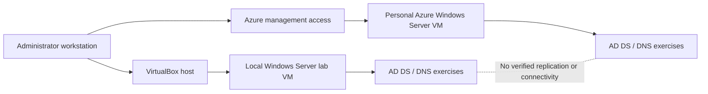

# Astra Windows Server & Virtualisation

**Documentation baseline:** 2026-11-16  
**Scope:** Personal lab only; not NHSBSA production infrastructure.  
**Evidence state:** Historical hands-on exercises recorded; current deployments and end-to-end validation require a fresh check.

## Purpose

Document the Windows Server, Active Directory Domain Services (AD DS), DNS and virtualisation work carried out in **Oracle VirtualBox** and **Microsoft Azure IaaS**. The goal is reproducibility and evidence of design, operation, troubleshooting and safe recovery—not just installation.

## What is supported by existing records

- A Windows Server VM was deployed in a personal Azure environment for AD DS administration exercises.
- OU organisation, role-based groups, delegated permissions, GPO exercises and a scheduled task running under a dedicated identity have been recorded.
- The lab owner reports a separate Windows Server/AD DS exercise using VirtualBox; configuration details and current operational state are not yet independently captured.
- The repository contains a read-only AD inventory PowerShell script and six **mocked** passing Pester tests; live domain-controller execution has **not** been demonstrated by those tests.

Do not infer that the VirtualBox and Azure directories are one domain, replicated, hybrid-synchronised, connected by VPN or currently running.

## Documentation index

| Document | Purpose | Current status |
| --- | --- | --- |
| [VirtualBox deployment](virtualbox-deployment.md) | Local hypervisor, VM lifecycle, networking and host boundaries | Written; configuration inventory pending |
| [Azure VM deployment](azure-vm-deployment.md) | Azure IaaS hosting, access, network controls and cost | Written; live configuration pending |
| [AD DS and DNS](adds-and-dns.md) | Directory architecture, DNS prerequisites, admin tasks and checks | Historical exercises recorded; live verification pending |
| [Group Policy](group-policy.md) | GPO design, scope, troubleshooting and rollback | Historical exercises recorded; effective-policy evidence pending |
| [Security and delegation](security-and-delegation.md) | Least privilege, role separation and service-account validation | Historical exercises recorded; test matrix pending |
| [Validation and recovery](validation-and-recovery.md) | Read-only checks, evidence register, restore exercises and sign-off | Test plan written; execution pending |

Also see the existing [Active Directory overview](../active-directory.md), [reference architecture](../architecture.md) and [portfolio evidence checklist](../../evidence/portfolio-evidence-checklist.md).

## Logical reference model

The diagram shows two **separate learning environments**. It is not an inventory of live VMs or proof of connectivity. Hostnames, IP addresses, VM sizes, OS build numbers and domain names must be confirmed privately; use placeholders in public documentation.

## Completion criteria

- [ ] Confirm actual VM(s), OS version and lifecycle state without publishing live identifiers.
- [ ] Record VirtualBox storage, firmware, NIC attachment and isolation choices.
- [ ] Record Azure resource layout, administrative access path, network rules and deallocation/cost controls.
- [ ] Capture sanitised AD DS, DNS, GPO and delegation test results from an authorised live lab.
- [ ] Test at least one controlled failure and a recovery/rollback procedure.
- [ ] Publish a dated evidence record distinguishing passed, failed, skipped and not-tested outcomes.
- [ ] Update the main roadmap and evidence checklist with verified outcomes.

**Important:** This documentation workstream is complete as a *runbook and evidence framework*, but the underlying technical validation is not yet complete.

## Public repository safety

Never commit secrets, private keys, real credentials, raw directory exports, public IPs or detailed live network identifiers. Use fictional identities and documentation-only addresses (e.g. `192.0.2.0/24`) in examples. Review screenshots for sensitive tabs, account names and metadata before publication.
