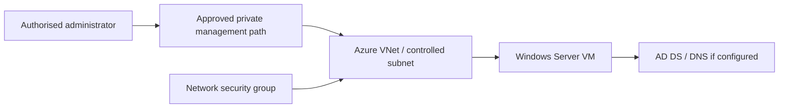

# Microsoft Azure — Windows Server IaaS Lab

**Status:** Historical deployment **recorded**; current VM state and configuration **not verified**.

## Objective and scope

Record the separate personal Azure-hosted Windows Server VM used for AD DS administration practice. An Azure VM is infrastructure-as-a-service (IaaS); it is not Microsoft Entra Domain Services and does not imply Entra Connect sync or connectivity to the VirtualBox lab.

## Components to inventory

| Layer | What to validate | Key risk |
| --- | --- | --- |
| Subscription/resource group | Appropriate personal lab scope | Unexpected spending |
| VM | Region, size, OS build, OS disk, current power state | Cost / unsupported configuration |
| Virtual network | VNet, subnet, private addressing, NSG | Unintended reachability |
| Management | Private admin path, Bastion/VPN if actually used, RBAC | Exposed RDP |
| DNS | VNet/custom DNS, DC self-resolution and client lookups | AD DS failures |
| Identity | Local admin, AD DS service accounts, Entra scope | Excess privilege |
| Recovery | Backup status, test restore scope and dependencies | Unrecoverable directory |
| Monitoring | VM metrics/logs and selected alerts | Undetected outage |

**Not verified:** Azure VM size, disk, NSG rules, public-IP allocation, backup, VNet connection to home, domain-controller role today and any cross-environment replication.

## Reference design (illustrative, not deployed topology)



## Operational safety

- Avoid exposing RDP (TCP 3389) to the public internet. Prefer a properly authenticated private route or Azure Bastion where suitable and affordable.
- Restrict NSGs to known required traffic; network controls are not substitutes for host firewall and strong authentication.
- For an AD DS domain controller, use a static **private IP assignment through Azure NIC configuration** and plan DNS dependencies carefully. Do not assume dynamic public IP continuity.
- Deallocate unused VMs to stop compute charges, while remembering disks, reserved public IPs and other resources may still incur charges.
- Review Microsoft guidance before changing an AD DS VM's disks, snapshots, restore state or networking.

## Read-only Azure CLI inventory example

Run in an authenticated context with authorised access, replacing placeholders:

```bash
az vm show --resource-group "<LAB_RG>" --name "<LAB_VM>" \
  --query "{name:name,location:location,vmSize:hardwareProfile.vmSize,provisioningState:provisioningState}" -o json
az vm get-instance-view --resource-group "<LAB_RG>" --name "<LAB_VM>" \
  --query "instanceView.statuses[].{code:code,displayStatus:displayStatus}" -o table
az network nic list --resource-group "<LAB_RG>" \
  --query "[].{name:name,privateIps:ipConfigurations[].privateIPAddress}" -o json
```

These queries are read-only; review results locally and sanitise before publishing. Azure RBAC permissions and CLI syntax may vary with version.

## Validation gates

- [ ] Confirm VM state and OS.
- [ ] Confirm who can administer the VM and via which path.
- [ ] Verify VNet DNS and NSG intention without exposing live rules.
- [ ] Check AD DS/DNS roles and Windows event logs if the server is available.
- [ ] Confirm budget, deallocation policy and remaining chargeable resources.
- [ ] Define and perform an appropriate, isolated recovery test before marking backup validated.

Link dated evidence in [validation and recovery](validation-and-recovery.md).
