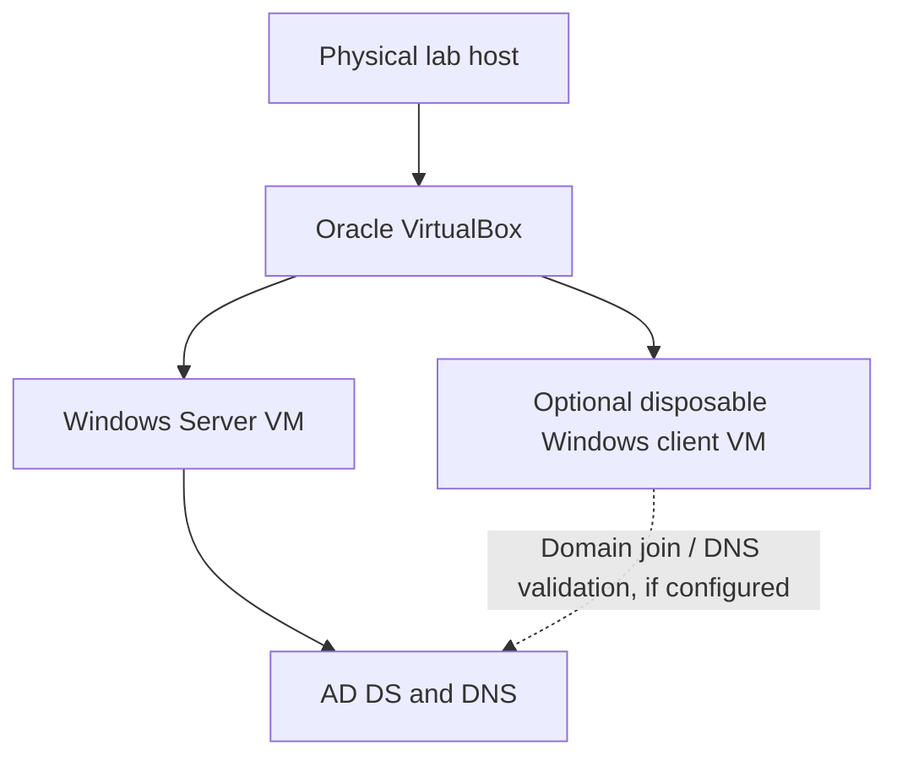

# Oracle VirtualBox — Windows Server Virtualisation

**Status:** Lab exercise reported by owner; current VM configuration **not yet inventoried**.

## Objective

Capture how a local Windows Server VM is provisioned, isolated, administered and recovered on an Oracle VirtualBox host. Do not mistake the example architecture below for confirmed deployed settings.

## Intended architecture



## Private inventory to verify

| Item | Record privately | Public evidence |
| --- | --- | --- |
| Hypervisor | VirtualBox version, host OS and CPU virtualisation availability | Versions and host class |
| VM | Windows Server edition/build; CPU and RAM; disk type and capacity | Sanitised resource summary |
| Storage | Controller, dynamic/fixed disk and backup approach | Storage design rationale |
| Firmware | BIOS/UEFI and secure-boot state if relevant | Verified state |
| Networking | NAT, NAT Network, host-only, internal or bridged attachment; adapters | Logical diagram and justification |
| Guest additions | Version and whether installed | Version / not applicable |
| Snapshots | Names, dates and rollback limitations | Count/policy, never claim snapshots equal backups |
| Server roles | AD DS, DNS and any additional roles | Installed role list |
| Test client | Existence, DNS settings, membership and isolation | Sanitised results |

**Network decision:** A domain lab with a client VM usually benefits from an isolated internal/host-only segment. NAT can provide outbound access if intentionally configured. Bridged networking directly exposes the guest to the attached LAN and should not be used without an explicit security rationale.

## Provisioning / reconstruction checklist

1. Confirm hardware, OS licensing, ISO provenance and available host resources.
2. Create an appropriately sized VM with virtual storage and chosen firmware settings.
3. Configure an isolated virtual network and document the expected DNS path.
4. Install Windows Server and apply supported updates.
5. Configure a stable private IP and DNS settings appropriate to the AD DS design.
6. Install and configure AD DS/DNS **only** in the disposable authorised lab.
7. Configure a separate lab administrator, normal user and optional test client.
8. Validate directory, DNS, time and Group Policy using [the validation plan](validation-and-recovery.md).
9. Record the baseline and a safe rollback path before making policy changes.

These are reproduction steps, **not** a claim all steps were performed in the existing VirtualBox environment.

## Safe read-only inspection

From the Windows Server guest (elevated PowerShell where required):

```powershell
Get-ComputerInfo | Select-Object WindowsProductName, WindowsVersion, OsBuildNumber
Get-NetAdapter | Select-Object Name, Status, LinkSpeed
Get-NetIPConfiguration
Get-WindowsFeature AD-Domain-Services, DNS
Get-Service NTDS, DNS -ErrorAction SilentlyContinue
```

From the VirtualBox host, if VBoxManage is installed:

```text
VBoxManage list vms
VBoxManage list runningvms
VBoxManage showvminfo "<LAB_VM_NAME>"
```

Redact UUIDs, paths, MAC addresses, hostnames and any real addresses from shared outputs.

## Snapshot and recovery rules

A snapshot offers a convenient lab rollback but is **not** an independent backup. Domain-controller restoration requires special care: restoring arbitrary/old snapshots can cause directory consistency problems, particularly in multi-DC environments. For AD recovery exercises, follow Microsoft's supported restore guidance and use isolated, disposable test systems. Never practise rollback on a production domain controller.

## Evidence still required

- [ ] Screenshot-free or sanitised VM configuration export.
- [ ] Network attachment description and isolation test.
- [ ] AD DS/DNS installed-role and service checks.
- [ ] Client name resolution and domain authentication tests, if a client exists.
- [ ] Recovery approach and one safely completed exercise.
